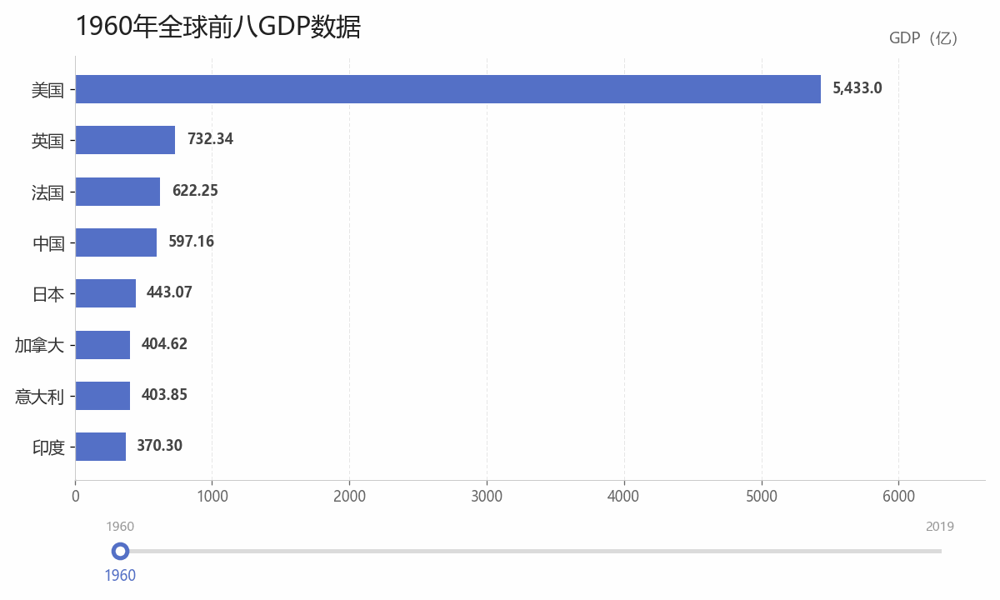
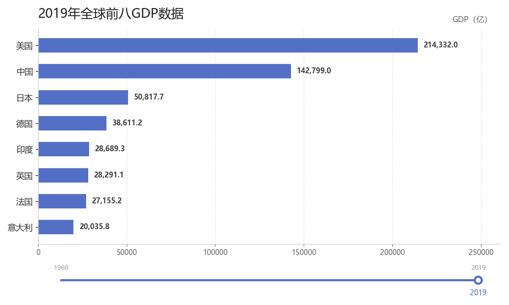
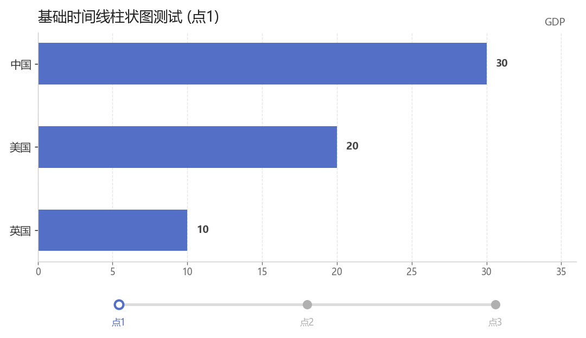

# Global GDP Visualization (1960-2019) / 全球GDP动态可视化 (1960-2019)

[](https://www.python.org/)
[](https://pyecharts.org/)
[](LICENSE)

[English](#english) | [中文说明](#chinese)

---

<a name="chinese"></a>
## 🇨🇳 中文说明

### 项目简介 (Project Overview)
本项目使用 Python 处理全球历史 GDP 数据，并利用 `pyecharts` 库生成交互式动态时间线柱状图。直观展示了 1960 年至 2019 年间全球前八大经济体的排名洗牌与经济体量变化。

### 运行效果 (Screenshots & Demo)

#### 1. 动态演变预览 (1960-2019)


#### 2. 起始年份与最终年份对比
| 1960年全球GDP前八国家 | 2019年全球GDP前八国家 |
| :---: | :---: |
|  |  |

#### 3. 基础时间线柱状图测试


---

### 技术栈 (Tech Stack)
* **语言:** Python 3.8+
* **可视化框架:** Pyecharts (基于 ECharts)
* **输出格式:** 交互式 HTML 网页

---

### 包含的文件 (Files)
* `data/1960-2019全球GDP数据.csv`: 历史 GDP 原始数据。
* `1960-2019全球GDP动态柱状图.py`: 数据清洗、排序截取前八名并生成时间线柱状图的核心脚本。
* `1960-2019全球gdp前八国家.html`: 核心输出网页，包含完整的历史数据展示与动画配置。
* `基础时间线柱状图.py`: Pyecharts Timeline 与 Bar 组件的基础测试用例。
* `基础时间线柱状图.html`: Pyecharts Timeline 组件的基础测试用例输出网页。
* `screenshots/`: 运行截图与动态演变 GIF。
* `requirements.txt`: 依赖清单。

---

### 快速开始 (Quick Start)

1. **克隆仓库**
   ```bash
   git clone https://github.com/Wong0813/global-gdp-visualization.git
   cd global-gdp-visualization
   ```

2. **安装依赖**
   ```bash
   pip install -r requirements.txt
   ```

3. **运行脚本**
   ```bash
   python 1960-2019全球GDP动态柱状图.py
   ```

4. **查看网页**
   使用浏览器打开生成的 `1960-2019全球gdp前八国家.html` 文件。

---

### 关于作者 (About)
本项目是作为自学 Python 数据可视化过程中的实战练习。重点掌握了数据的整理格式化、Pyecharts 的 `Bar`（柱状图）与 `Timeline`（时间线）组件的联合使用技巧。

---

<a name="english"></a>
## 🌐 English Description

### Project Overview
This project processes historical global GDP datasets with Python and uses `pyecharts` to generate interactive dynamic timeline horizontal bar charts, showing the ranking and economic changes among the world's top 8 economies from 1960 to 2019.

### Demo & Screenshots

#### 1. Dynamic Evolution Preview (1960-2019)


#### 2. Comparison: 1960 vs 2019
| Top 8 in 1960 | Top 8 in 2019 |
| :---: | :---: |
|  |  |

#### 3. Basic Timeline Bar Test


### Tech Stack
* **Language:** Python 3.8+
* **Visualization:** Pyecharts (Apache ECharts)
* **Output Format:** Interactive HTML

### Files
* `data/1960-2019全球GDP数据.csv`: Historical GDP dataset.
* `1960-2019全球GDP动态柱状图.py`: Core data processing and timeline chart generation script.
* `1960-2019全球gdp前八国家.html`: Main interactive visualization output.
* `基础时间线柱状图.py`: Basic test case script for Pyecharts Timeline component.
* `基础时间线柱状图.html`: Output for the basic test case.
* `screenshots/`: Screenshots and animated GIF preview.
* `requirements.txt`: Python package requirements.

### Quick Start
```bash
# Clone repository
git clone https://github.com/Wong0813/global-gdp-visualization.git
cd global-gdp-visualization

# Install dependencies
pip install -r requirements.txt

# Run generation script
python 1960-2019全球GDP动态柱状图.py

# Open '1960-2019全球gdp前八国家.html' in any web browser.
```

### About
This project was developed as a milestone during self-learning Python data visualization, focusing on data formatting, cleaning, and combined usage of Pyecharts `Bar` and `Timeline` components.
